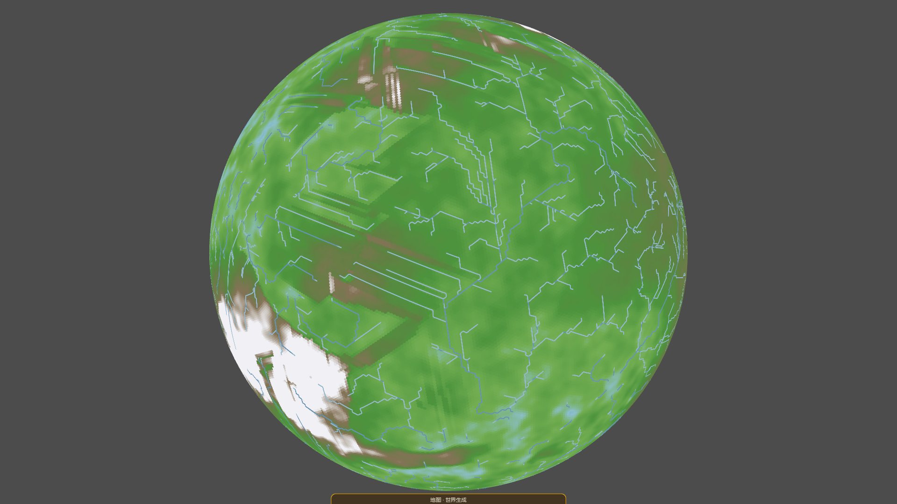
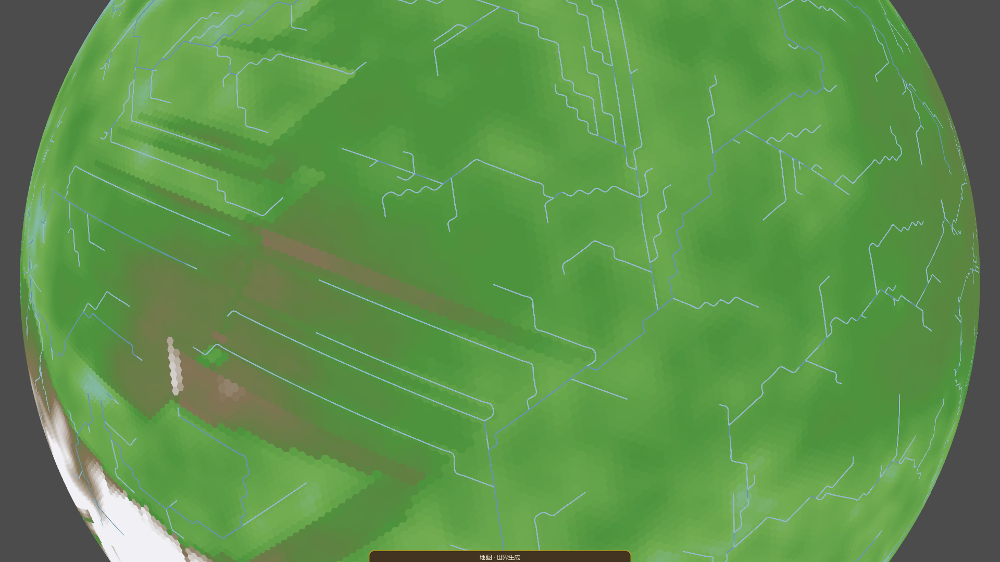
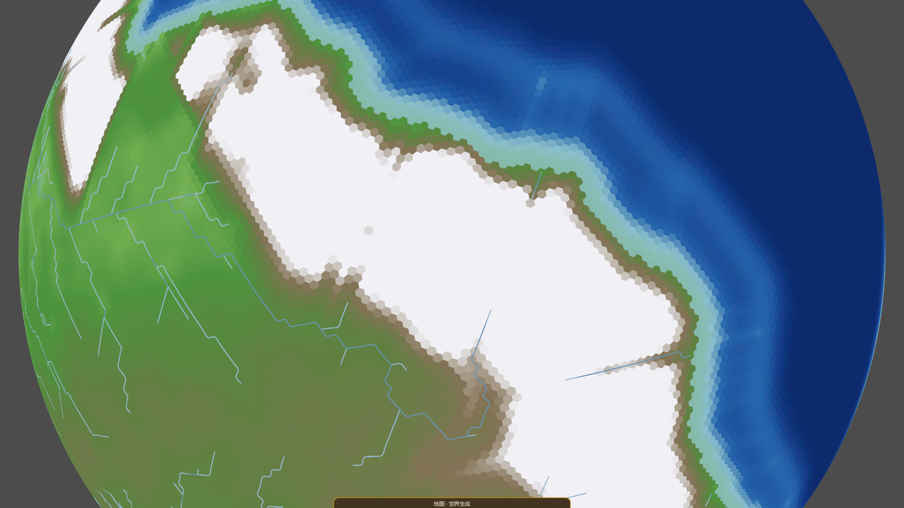

# 设计 · 地形真实感改造（Terrain Realism Upgrade）

- 状态：**已实施（Phase 1–4，2026-10-20）**
- 日期：2026-10-19
- 范围：① 地形阶段（`TerrainPipeline` / `TerrainManager` / `HighlandOps` / `ErosionOps`）＋ 海拔表现层（`ElevationMode` / `BallView`）
- 前置阅读：[设计-板块阶段（合并海陆）](<设计-板块阶段（合并海陆）.md>) §十三～§十七，尤其：
  - §15.4 的**采样下限**（最细倍频层 ≥ 3 × 邻格中心距 ≈ 7.41 km）；
  - §17 的**世界尺度**（res4、288,122 格、每格 5 km²、R ≈ 338.586 km、邻格中心距 2.469 km）。
- 一句话结论：当前地形“不像真实地形”的主因**不是 FBM 层数不够**，而是
  **坡度太平、陆地太多、表现层没有光照**。按“表现层 → 宏观形态 → 山体/侵蚀 → 分布重映射”
  四步改，收益/风险比最高。

---

## 〇 摘要（先看这 8 条）

1. **实测基线**（seed 42、默认档、`Layout=Auto→Earthlike`、res4）：
   - 陆地 **52.15%**（Earth ≈ 29%），海洋 47.85%；
   - 陆地坡度中位数 **1.17 m/km**（0.117%），p90 **5.51 m/km**（0.55%），p99 **22.76 m/km**（2.28%）；
   - **95.0% 的陆地坡度 < 1%**，只有 **0.1% 的陆地坡度 > 5%**；
   - `Mountain` 档（96–149 m）平均坡度只有 **4.16 m/km**（0.42%），`Snow` 档（>149 m）也只有 **10.08 m/km**（1.0%）；
   - 雪线以上占陆地 **6.3%**，在海拔模式里是一整块纯白，而不是山顶积雪。
2. **三个根因**：
   - 山带是 30–70 km 宽的高斯带，峰高只有 255 m ⇒ 宽高比约 1:120～1:270，天生就是“缓丘”而不是“山脉”；
   - 陆壳占比 0.5，加上山带/高原把大量陆壳抬过海面 ⇒ 陆地过半，海岸线简单、海洋偏小；
   - 表现层是 `unshaded` 的逐格纯色，一格一色（全景约 1.65 px/格），没有山体阴影、没有岩雪过渡、没有微纹理。
3. **不要直接照搬“6–8 层 octave”**：在 res4 上，`550 km` 基波长的安全上限是 7 层（最细 8.6 km），
   当前 2 层不是瓶颈；中/细节档当前 3/2 层已经贴着 3× 下限（8.0 / 8.5 km），再加层只会混叠成条纹。
   真正要加的是**中频段的形变**（域扭曲、山带曲率、山脊骨架），不是更多高频层。
4. **Persistence 也不是主旋钮**：本项目的 `SphericalFbmNoise` 用 **RMS 归一**，振幅与层数解耦；
   把 gain 从 0.5 调到 0.65 只会让最细层更毛，不会把缓丘变成山脉。山形要靠**山带宽度/峰高/侵蚀**。
5. **四阶段路线**：
   - Phase 1 表现层（不改高度场）：连续海拔色带 + 山体阴影 + 岩雪/海岸过渡 + 微纹理；
   - Phase 2 宏观形态：陆壳占比 0.5→0.38、山带收窄/增高/不对称、域扭曲海岸与山带；
   - Phase 3 山体与侵蚀：ridged 山脊骨架 + 导数抑制 + 沉积/热力侵蚀/平原下切；
   - Phase 4 分布重映射：hypsometric gamma + 平原偏置 + 坡度掩码 + 气候雪线。
6. **目标区间**（不是死数，按 seed 矩阵验收）：
   - 陆地 35–42%（Earthlike/Pangea；ManyContinents 可到 ~50%，Archipelago 12–22%）；
     陆地坡度 p90 10–18 m/km、p99 35–55 m/km；
   - `Mountain` 档平均坡度 10–18 m/km；雪覆盖 1–3% 陆地；海岸格 5–8% 陆地；
   - 同一 seed 的高度场可复现；除 Phase 2 的海岸改造外，海岸线位移 ≤ 1 格。
7. **最大风险**：改高度分布会让**所有 seed、河网、气候、旧截图**全部变样；必须先冻结基线、
   每阶段单独提交、用固定 seed 矩阵做 A/B，不要把“表现层”和“高度场”混在一个提交里。
8. **本方案不做什么**：不重写管线、不全局上 res5、不移植液滴侵蚀、不把 ridged 噪声用在
   3 格以下脊距、不为“真实”牺牲 `FinalLand = 高度 > SeaLevelM` 这条世界事实口径。

> **最小可行路径（MVP）**：Phase 1（表现层）＋ §6.1（陆壳占比 0.38）＋ §6.3.1（山带收窄/增高）。
> 先不做域扭曲/侵蚀/remap，约 1–2 天就能看到最大的观感变化；再按需加 Phase 2b–4。

---

## 一 现状审计

### 1.1 审计方法

- 世界：`res/params/world_params.json` 默认档，`Seed=42`，`Layout=Auto`（实际抽到 `Earthlike`），
  `PlateCount=8`，`ContinentalRatio=0.5`，4 块陆壳板块。
- 分辨率：`WorldManager.ProductionRes = 4`，288,122 格，邻格中心距 2.469 km。
- 指标：
  - 高度分位（全陆 / 全海）；
  - `ElevationBands` 九档计数；
  - 逐格坡度 = 到 6 邻居的**最大落差 / 邻格中心距**（m/km；1% = 10 m/km）；
  - 1-ring 局部起伏 = 邻居最大高度 − 最小高度；
  - 海岸格 = 至少一个邻居 ≤ 海面的陆格。
- 画面：1920×1080，默认相机（`1.7R`），海拔模式；另拍两张近景（陆地中心、最高峰）。
- 审计工具是临时的（`scratch/`，不入库）；建议按 §十一 收编为常驻诊断。

### 1.2 数字基线

| 指标 | 实测（seed 42） | 备注 |
|---|---:|---|
| 格数 | 288,122 | res4 |
| 陆地 / 海洋 | **52.15% / 47.85%** | Earth 陆地 ≈ 29% |
| 陆地高度 min / mean / max | 0.00 / 51.83 / **502.99 m** | max > `MountainPeakM=255`，因老山/丘陵/高原是加性叠加、不参与压峰 |
| 陆地高度分位 | p50 27.14 / p90 121.75 / p99 269.98 m | 长尾由山带+老山贡献 |
| 海洋深度 min / mean | −393.29 / −166.36 m | 最深未到 `OceanDeepestM=−558` |
| 陆地九档占比 | Lowland 32.0% / Plain 30.6% / Highland 20.9% / Mountain 10.2% / Snow **6.3%** | 雪线 149 m |
| 陆地坡度 p50 / p90 / p99 / max | **1.17 / 5.51 / 22.76 / 74.17 m/km** | 即 0.12% / 0.55% / 2.28% / 7.42% |
| 陆地坡度 < 0.2% / < 0.5% / < 1% / < 2% / > 5% | **73.8% / 88.9% / 95.0% / 98.6% / 0.1%** | 几乎全境是“平板” |
| 1-ring 起伏 p50 / p90 / p99 | 5.77 / 29.07 / 94.17 m | 局部高差也偏小 |
| 各档平均坡度 | Lowland 0.98 / Plain 1.70 / Highland 2.93 / **Mountain 4.16** / **Snow 10.08 m/km** | 山档仍远低于真实山地（100–300 m/km） |
| 海岸格 | 5,527（**3.7%** 陆地） | 海岸线偏短、偏简单 |

> 口径提醒：`Mountain` 档是“海拔 96–149 m”，不是“坡度像山”。在当前世界尺度上，
> 96 m 只相当于半径的 0.028%，把它叫 Mountain 是语义标签，不是形态判断。

### 1.3 画面基线

#### 全景（海拔模式）



- 陆地几乎铺满可见半球（52% 全球陆地）；绿色大面积连续，只有边缘/高山出现棕色和白色。
- 河流是浅蓝折线，能直接看出“沿格轴走”的长直段和直角折返。
- 白色雪区是一整块高原，不是山顶积雪；看不出山脊、谷地、岩雪过渡。

#### 陆地近景（陆地中心）



- 大块纯绿/黄绿色，没有山体阴影；六边形格边在全景不明显，近景直接暴露为马赛克。
- 河流是浅蓝细线，出现**长直平行段、直角折线、梳齿状支流**；这是“近平坦地形 + 单流向路由”
  的共同产物，不是真实河网。
- 没有河谷：河流只是画在表面上的线，地形本身没有被水系切开。

#### 最高峰近景



- 最高处是一大块**纯白高原**（雪线档），边缘是细窄的棕色“山档环”，再外面直接是绿色低地。
- 山体没有脊线、没有阴坡/阳坡、没有岩壁；从“山峰”到“平原”的过渡是色带边界，不是地形过渡。
- 白色区域边缘呈六边形锯齿，说明它完全由逐格色档决定，没有亚格尺度的雪线/岩石掩码。

### 1.4 诊断：为什么看起来不真实

#### ① 陆地太多，海岸线太“省事”

- `ContinentalRatio=0.5` ⇒ 8 块板块里 4 块陆壳；陆面基线 9.6 m 穿过海面后，
  山带/高原又把大量陆壳抬过海面 ⇒ 最终陆地 52%。
- 结果是一个“半球的陆 + 半球的洋”的二分画面；海岸线由大尺度 FBM 穿过海面形成，
  波长 550 km，缺少 10–50 km 级的海湾、半岛、岬角、岛链。
- 真实地球的海岸线是**多尺度**的：大陆轮廓（1000 km）+ 海湾（100 km）+ 岬角（10 km）+ 礁石（1 km）。
  当前只有第一档。

#### ② 山带太宽、太矮，坡度低了一个数量级

- 山带 = `MountainUpperBandKm 30` + `MountainBandConvSpreadKm 40 × 汇聚强度` ⇒ 满强度 70 km 宽；
  峰高归一目标只有 `MountainPeakM=255 m`。
- 高斯带的平均坡度约 `0.6 × H / w`：`0.6 × 255 / 30 ≈ 5.1 m/km`，再经平滑/侵蚀略降 ⇒
  实测 `Mountain` 档 4.16 m/km。真实山地平均 100–300 m/km，差 **20–70 倍**。
- 这不是“噪声不够细”，而是**宽高比**问题：把一条 255 m 高的山脊铺到 30–70 km 宽，
  它必然是缓坡。加 octave 只会在这条缓坡上加毛刺。

#### ③ 雪是“海拔档”，不是“山顶积雪”

- `ElevationBands` 的雪线是 149 m；`ElevationMode` 在雪线档内很快过渡到
  `(0.94, 0.94, 0.96)` 的纯白。
- 只要高度进入雪线档（149 m 以上），颜色就迅速变白，于是 6.3% 的陆地成了“白色高原”；
  没有坡度、坡向、纬度、温度、岩石暴露的调制。
- 近景里白色边缘是六边形锯齿，进一步强化“色块”感。

#### ④ 表现层没有光照，逐格纯色

- `BallView` 的 shader 是 `render_mode unshaded`，`ALBEDO = texture(elev_tex, UV).rgb`；
  没有法线、没有方向光、没有环境遮蔽、没有微纹理。
- 全景约 1.65 px/格，近景一格几十像素；一格一色 ⇒ 近景必然是马赛克。
- 这不是“地形数据不真实”的唯一原因，但它是**感知真实感的第一大杀手**：
  同样的高度场，加山体阴影/岩雪/微纹理后，观感会提升一个档次。

#### ⑤ 河流是“网格折线”，不是“地形河谷”

- `H3Hydrology` 是单流向：每格选严格最低的邻居；在近平坦面上，流线容易沿六边形格轴走，
  形成长直段、直角折返、平行梳齿。
- `RiverPresentationSpline` 只负责把折线画得连续，不能把“直角折线”变成“蜿蜒河谷”；
  地形本身也没有被河流切开（① 阶段的侵蚀只作用于构造抬升，不碰陆面基底）。
- 这是地形的连带问题：**坡度和高频起伏上来之后，单流向的退化会减轻**；但要真正像河网，
  还需要多流向/汇流面积/河谷下切，见 §7.4。

#### ⑥ 采样极限锁死了“更多 octave”

- 项目纪律：任何噪声场最细倍频层 ≥ 3 × 邻格中心距 = **7.41 km**；否则在六边形格上混叠成条纹。
- 当前：
  - 大尺度 550 km / 2 层：最细 275 km，远未到极限；
  - 中尺度 32 km / 3 层：最细 8.0 km，贴着极限；
  - 细节 17 km / 2 层：最细 8.5 km，贴着极限。
- 所以“把 octave 加到 6–8”只对大尺度有意义；中/细节再加层会直接违反采样下限。
  而大尺度加层产生的是 137/68/34/17/8.6 km、振幅 24/12/6/3/1.5 m 的细节，
  对“山看起来像山”帮助很小。

### 1.5 已经做对、不要重写的部分

- **管线顺序正确**：板块 → 地形 → 事实 → 气候 → 水文；地形内部是“基底 → 构造抬升 → 细化/侵蚀”，
  与参考里的“先结构、后侵蚀”一致。
- **确定性纪律好**：`SphericalFbmNoise` 零可变状态、种子派生独立、逐格并行只写自己；
  新算子必须沿用这套纪律。
- **`SphericalFbmNoise` 的 RMS 归一**是对的：振幅与层数解耦，比常见的 `Σgain` 归一更可控；
  不要为了“更像参考”改回振幅和归一。
- **`SampleRidged` 已经存在**（`(1−|n|)²` + 前层门控 + 振幅和归一），只是目前主要用于老山；
  它可以在安全尺度上承担山脊骨架。
- **虚拟侵蚀的方向是对的**：不做时间演化的物理求解，只要形状；这比在 288k 格上跑液滴侵蚀
  更适合当前项目。
- **参数分工纪律**：物理旋钮进 `TerrainSpec`，纹理尺度/分位留实现常量；
  新参数不要破坏这条。

---

## 二 “真实”的可验收定义

### 2.1 三个尺度，先对齐期望

| 尺度 | 典型尺寸 | res4 能表达什么 | 本方案对应 |
|---|---|---|---|
| 全球/大陆 | 1000–2000 km | 海陆分布、大陆轮廓、山系走向、岛弧 | Phase 2 |
| 区域 | 20–200 km | 山带宽度、高原、盆地、海岸湾岬、流域 | Phase 2–3 |
| 局部 | 1–20 km | 山坡、河谷、阶地、岩壁；**受 2.469 km 格距限制** | Phase 3 + 表现层 |

> 重要：这是一个半径 338.586 km 的小世界，一格 2.469 km 约等于地球上的 46 km。
> 在 res4 上追求“照片级山坡”是不现实的；目标是**地图/球面视角的可信地形**，
> 近景靠山体阴影、岩雪掩码、微纹理补足，而不是靠几何。

### 2.2 目标指标

| 指标 | 当前 | 目标 | 理由 |
|---|---:|---:|---|
| 陆地占比 | 52.15% | **35–42%**（Earthlike/Pangea） | 接近 Earth；ManyContinents 可到 ~50%，Archipelago 12–22% |
| 陆地坡度 p50 | 1.17 m/km | 2–4 m/km | 平原仍平，但不再是“桌面” |
| 陆地坡度 p90 | 5.51 m/km | **10–18 m/km** | 让 10% 的陆地有“山地感” |
| 陆地坡度 p99 | 22.76 m/km | **35–55 m/km** | 陡坡/山脊可见 |
| `Mountain` 档平均坡度 | 4.16 m/km | **10–18 m/km** | 山档名副其实 |
| 1-ring 起伏 p90 | 29.07 m | 45–70 m | 近景有高差 |
| 雪覆盖（陆地） | 6.3% | **1–3%** | 雪是山顶/高纬，不是整块高原 |
| 海岸格（陆地） | 3.7% | **5–8%** | 海湾/半岛/岛链增加岸线长度 |
| 陆地 max | 503 m | 550–750 m | 允许老山叠加；不要失控 |
| 生成耗时增量 | — | ① 阶段 < +30% | 域扭曲/侵蚀不能把启动拖垮 |

> 这些是**方向性区间**，不是每 seed 必须命中的死数。验收看 4 seed × 4 layout 的分布，
> 不看单张图“像不像”。

### 2.3 表现层目标

1. **连续海拔色带**：至少 12–16 个停点，深海→浅海→沙岸→低地→平原→高地→山地→裸岩→雪；
   不再用 9 个档中点色做“大色块”。
2. **山体阴影**：逐格法线 + 固定方向光 + 环境光；阴坡/阳坡可读，山脊线自然浮现。
3. **岩雪掩码**：雪按“高度 × 坡度 × 温度/纬度 × 噪声”混合，陡坡露岩，雪线呈斑块状。
4. **海岸过渡**：浅水渐变 + 岸线亮边 + 低地沙色，避免“蓝色直接切绿色”。
5. **微纹理**：近景在 shader 里叠一层高频噪声/细节纹理，打散逐格纯色；全景淡出，避免噪点。
6. **可选生物群系**：用 ③ 气候的降水/温度给低地染植被色，山地按坡度露岩；这比单纯海拔色更“像地表”。

---

## 三 参考技术 → 本项目落点

| 参考 | 原建议 | 在本项目是否适用 | 落点 / 修正 |
|---|---|---|---|
| FBM 参数经验（patterns.md） | Octaves 6–8；Persistence 0.3–0.4 丘陵、0.5 标准、0.6–0.7 崎岖 | **部分适用** | 先看 3× 采样下限；大尺度可到 7 层，中/细节已贴限。gain 只改纹理，不改山形。见 §3.1、§9 |
| NASA FRACGEN | 种子、分形维数影响地形 | 适用 | 种子派生已严格；分形维数≈`gain`/`lacunarity`，不要新增“fractal dimension”魔数 |
| The Book of Shaders · FBM | 自相似性是关键 | 已实现 | `SphericalFbmNoise` 就是 3D Perlin + fBm；问题在幅度谱与构造掩码，不在噪声基 |
| IQ · Domain Warping | 用噪声扭曲采样坐标；双重扭曲 | **非常适用，当前缺失** | 新增 `DomainWarpOps`；先扭曲陆面基底，再扭曲海岸/山带距离场。见 §6.2 |
| IQ · Derivative FBM | 跟踪解析梯度，抑制陡峭区高频 | 部分适用 | 用有限差分坡度做“细节抑制/岩雪掩码”即可；不必上解析导数。见 §7.2 |
| IQ · Bandlimiting | 防止超过 Nyquist 的频率 | **项目已有纪律，但未强制** | 增加 `NoiseSampling.SafeOctaves` 守卫 + 诊断；见 §9.4 |
| IQ · Ridged Noise | `1−abs(fbm)` 造山脊 | 已有更好实现 | `SampleRidged` 已是 `(1−|n|)²` + 门控；用在**山带骨架**（60–100 km），不要用在 <3 格脊距的细节 |
| Gaea · Understanding Erosion | 基础形状 → Warp → 多次 Erosion | 适用 | 当前是“基底 → 构造 → 细化 → 侵蚀”；在构造后加一层 Warp，侵蚀加强。见 §7.3 |
| 论文《Eroded Fractal Terrains》 | FBM 初始高度场 → 侵蚀 | 已遵循 | 本项目还多了板块/山带掩码，顺序正确；差距在侵蚀强度与沉积 |
| symbios-ground / Sebastian Lague | 液滴水力侵蚀 + 热力侵蚀 | **暂不移植** | 288k H3 + 确定性并行 + 时间成本不划算；用虚拟侵蚀 + 沉积/热力近似。见 §7.3 |
| Stack Overflow · Playable Heightmap | 自定义曲线重映射，造平坦区 | **非常适用，当前缺失** | 新增 hypsometric remap；只作用于海面以上，保海岸。见 §8 |
| 坡度/法线 · `normal·Y` | 坡度阈值做植被/岩石掩码 | 适用 | `TerrainMode` 里做岩雪/植被混合；玩法侧可用于通行/建造。见 §8.3 |
| GDC · REDengine 3 / No Man's Sky / Sir | 自动化、流式、生物群系 | 架构层面参考 | 本项目已有分阶段管线与确定性种子；流式/生物群系不是当前瓶颈，不照搬 |
| lore-weave · selector masks | 用坡度/高度控制细节/纹理/侵蚀位置 | 适用 | 用 `coastMask`、`slopeMask`、`snowMask` 把算子限制在正确位置；见 §6.3、§8.3 |
| 知乎 UE5 地形 | FBM + WarpingStrength | 适用 | `WarpingStrength` 对应 `LandWarpKm`；从 0.1×特征尺度起步 |
| 中文调参口诀 | 先 freq 再加 octave，warp 最后上且从 0.1 起步 | 适用 | 本方案调参顺序：波长 → 层数 → gain → warp → 侵蚀 → remap；见 §9.5 |

### 3.1 对“6–8 层 octave”的具体修正

以 res4、邻格 2.469 km、下限 7.41 km 为例：

| 场 | 基波长 | 安全层数上限 | 当前 | 建议 | 说明 |
|---|---:|---:|---:|---:|---|
| 大尺度 | 550 km | 7（最细 8.6 km） | 2 | **3–4** | 加 137/68 km 的中频，帮助大陆内部起伏；不必到 7 |
| 中尺度 | 32 km | 3（最细 8.0 km） | 3 | **3** | 已贴限，不再加 |
| 细节 | 17 km | 2（最细 8.5 km） | 2 | **2** | 已贴限，不再加 |
| 山脊（ridged） | 70 km | 3（脊距 8.75 km） | — | **2–3** | 脊距 = 基波长 / 2^层数，必须 ≥ 3 格 |
| 山体细化 | 27 km | 2（最细 13.5 km） | 2 | **2** | 保持普通 fBm，不要换 ridged |

> 公式：普通 fBm 第 `o` 层波长 = `base / 2^(o−1)`；ridged 的**脊距** ≈ 最细层波长 / 2。
> 选层数时用“最细层 ≥ 3 格”，选 ridged 时用“脊距 ≥ 3 格”，两者不是同一个数。

### 3.2 对“Persistence 0.6–0.7 造崎岖山脉”的修正

- 本项目的 `gain` 是全局固定的 0.5（构造函数默认），且按 RMS 归一；把 gain 调高，
  最细层振幅相对变大，画面会“毛”，但山带的**宽高比**不变。
- 若要“崎岖”，正确顺序是：
  1. 先把山带收窄/增高（改变宽高比）；
  2. 再用 ridged 骨架 + 侵蚀刻出脊谷；
  3. 最后才用 gain 调“粗糙度”。
- 因此本方案**不新增全局 `Persistence` 旋钮**；只在 `ErosionOps` 的细化噪声上允许
  `MountainDetailAmount` 增大（0.4→0.55），并保持 gain=0.5。

---

## 四 改造总览

```
Plate（板块/壳型）
  ↓
Terrain（①）
  ├─ 陆面基底：LandBase + 三档 FBM
  │    └─ ★ DomainWarp（陆面/海岸）           [Phase 2]
  ├─ 构造高地：山带 + 老山/丘陵 + 高原
  │    ├─ ★ 山带距离场 Warp（走向弯曲）        [Phase 2]
  │    ├─ ★ 不对称带宽 + 收窄/增高             [Phase 2]
  │    ├─ ★ Ridged 山脊骨架                    [Phase 3]
  │    └─ ★ 导数抑制（陡坡细节）               [Phase 3]
  ├─ 山体细化 + 虚拟侵蚀
  │    ├─ ★ 沉积 / 热力 / 平原下切             [Phase 3]
  │    └─ （可选）★ 水文引导二次侵蚀           [Phase 5]
  ├─ ★ Hypsometric Remap（陆地分布）           [Phase 4]
  └─ HeightM
  ↓
Facts → Climate → Hydrology（★ 改高度后必须重跑）
  ↓
Render（表现层）
  ├─ ★ 连续色带 + 山体阴影 + 岩雪/海岸掩码     [Phase 1]
  ├─ ★ 微纹理 / 可选法线                       [Phase 1/5]
  └─ 河流叠加（★ 地形变后重看河网）
```

原则：
- **先表现层，后高度场**：先确认“同样的高度场能不能看起来更真实”，再决定改多少高度。
- **每次只动一类旋钮**：表现层 / 陆量 / 山带几何 / 侵蚀 / remap 分提交。
- **所有新算子保持确定性**：只读共享态、只写自己、种子独立、逐位可复现。

---

## 五 Phase 1：表现层（不改高度场）

> 目标：在 `HeightM` 完全不变的前提下，把“色块地图”变成“有起伏的地图”。
> 这是收益最高、风险最低的一步；如果这一步做完仍然觉得假，再动高度场。

### 5.1 连续海拔色带

> 先补一条容易被忽略的：`WorldGenMapModes.CreateAll` 的注册序[0] 当前是 **`PlateMode`**，
> 所以启动第一眼看到的是“板块色块”，不是地形。要让地形真实感成为第一眼，把
> `TerrainMode`/`ElevationMode` 放到注册序首位，并同步 `MapDock.tscn` 的按钮顺序与文案；
> 否则 Phase 1 做完，默认画面仍然是 §1.3 第一张图那种大色块。
>
> 如果选择**新增** `TerrainMode` 而不是就地升级 `ElevationMode`，旧模式仍会显示硬雪线/旧色带；
> 验收与初始模式都必须指向新模式，别拿旧模式截图做对比。

现状：`ElevationMode.Ramp` 只有 9 个锚点（每个档的中点），档内线性插值；颜色对比弱，
大面积仍是“接近常数”的绿色。改法：

- 新增 `TerrainPalette`（或直接扩 `ElevationMode.Ramp`）到 14–16 个停点；
- 用 `ColorRamp.RampSampleSmooth`（Catmull-Rom）而不是线性，让色带在档界处更自然；
- 保留 `ElevationBands` 作为**判读/文案**的唯一口径，不把色带写进 `ElevationBands`；
- 色带停点示例（米）：

```csharp
static readonly ColorRamp.ColorStop[] Stops =
{
    new(-400f, new Color(0.03f, 0.09f, 0.28f)),   // 深渊
    new(-220f, new Color(0.05f, 0.16f, 0.42f)),   // 深海
    new(-90f,  new Color(0.08f, 0.27f, 0.56f)),   // 大洋
    new(-25f,  new Color(0.14f, 0.42f, 0.66f)),   // 浅海
    new(-6f,   new Color(0.32f, 0.62f, 0.74f)),   // 岸棚
    new(-1f,   new Color(0.62f, 0.80f, 0.78f)),   // 岸线浅水
    new(0f,    new Color(0.78f, 0.76f, 0.58f)),   // 沙滩
    new(4f,    new Color(0.48f, 0.66f, 0.34f)),   // 低地
    new(18f,   new Color(0.34f, 0.56f, 0.26f)),   // 平原
    new(45f,   new Color(0.40f, 0.52f, 0.26f)),   // 高地
    new(85f,   new Color(0.50f, 0.46f, 0.32f)),   // 山地
    new(140f,  new Color(0.56f, 0.50f, 0.44f)),   // 裸岩
    new(220f,  new Color(0.82f, 0.82f, 0.84f)),   // 高山岩雪
    new(320f,  new Color(0.96f, 0.97f, 0.99f)),   // 雪
};
```

> 注意：这是**表现层色带**，不是世界事实。`ElevationBands` 仍按 0/16/48/96/149 判读；
> 两者可以不一致——就像地图上的“高山”不等于“雪线”。Phase 1 会暂时出现
> “画面雪线（~200 m）≠ 判读雪线（149 m）”；这是有意的，Phase 2 会重标定档界。
> 信息卡文案应写“判读档”，不要写“画面雪线”。

### 5.2 山体阴影（hillshade）

在 `TerrainMode.CellColorAt`（或升级后的 `ElevationMode`）里，用邻居高度算逐格法线：

```csharp
// 返回单位法线；exaggeration = 1 表示真实坡度，4–6 表示 Phase 1 的视觉夸张
static Vector3 SurfaceNormal(Ball ball, float[] h, int i, float exaggeration)
{
    Vector3 p = ball.CellDirs[i];
    Vector3 grad = Vector3.Zero;
    int count = 0;
    foreach (int j in ball.CellNeighbors[i])
    {
        Vector3 d = ball.CellDirs[j] - p;
        d -= p * d.Dot(p);                 // 去掉径向分量，只留切向
        float len = d.Length();
        if (len < 1e-6f) continue;
        float distKm = SphericalFbmNoise.WorldRadiusKm * len;
        float slope = (h[j] - h[i]) / MathF.Max(distKm, 1e-3f);  // m/km
        grad += d / len * slope;
        count++;
    }
    if (count > 0) grad /= count;
    // m/km → 无量纲：1 m/km = 0.001
    return (p - grad * (0.001f * exaggeration)).Normalized();
}
```

```csharp
Vector3 n = SurfaceNormal(ball, h, i, exaggeration: 4.0f);
Vector3 light = new Vector3(-0.45f, 0.75f, 0.50f).Normalized();
float ndl = MathF.Max(0f, n.Dot(light));
float shade = 0.58f + 0.42f * ndl;      // 环境光 0.58，避免阴坡全黑
Color c = ColorRamp.RampSampleSmooth(Stops, h[i]);
c = new Color(c.R * shade, c.G * shade, c.B * shade);
```

要点：
- `exaggeration`：Phase 1（当前坡度 1–5 m/km）用 **4–6**，否则阴影几乎看不见；
  Phase 2 坡度上来后降到 **2–3**。这是**表现夸张**，不是改高度，必须写进图例/文档。
- 光方向固定在世界空间，球面旋转时会有“晨昏线”；如果嫌阴坡太暗，把环境光提到 0.65。
- 不要用 `normal·Y` 代替完整法线：在球面上“Y”不是局部上方向；必须用**格心方向**做局部天顶。
- 性能：法线/坡度在 `BeginBake` 里一次算好（O(n)），`CellColorAt` 只查表；
  不要在每格取色时重算 6 邻居。
- 全景 1.65 px/格时，hillshade 会让山带立刻“立起来”；近景也能看出坡向。

### 5.3 岩雪掩码（替换硬白）

现状：`ElevationMode.BandColor(Snowline)` 接近纯白，`ElevationBands` 雪线 149 m，
导致 6.3% 陆地很快变白。

改法（表现层）：
- 雪线不再由 `ElevationBands` 单独决定，而是：
  ```text
  snow = smoothstep(snowline - 20, snowline + 20, h)
       × (1 - 0.75 × rock)                  // 陡坡露岩
       × (0.55 + 0.45 × snowNoise(dir))     // 斑块状，不是整格白
       × latitudeFactor                     // 高纬更低，赤道更高（可选）
  ```
- `snowline`：Phase 1 山高未变，先用 `190–210 m`（当前峰高 255 m）；Phase 2 峰高上来后
  按新分布 p97 调到 `240–300 m`。`snowNoise` 用 8–15 km 波长的 fBm（**1 层**，≥3 格，安全）。
- 岩石：`rock = smoothstep(0.12, 0.55, slope01)`，`slope01 = clamp(slope / 100 m/km, 0, 1)`；
  陡坡把颜色拉向灰褐，雪在陡坡上被“刷掉”。
- 结果：山顶有雪、陡壁露岩、雪线呈斑块；不再是一整块白色高原。

> 如果不想在 `ElevationMode` 里引入噪声/气候依赖，可以新建 `TerrainMode`，保留
> `ElevationMode` 作为“纯海拔判读”模式；但地图坞按钮数量要同步（`MapDock.tscn` 的 `ModeRow`）。

### 5.4 海岸与浅水

- 浅水：`h ∈ [−6, 0]` 用青绿→沙色渐变，而不是直接蓝→绿；
- 岸线亮边：`coast = 1 − smoothstep(0, 1.5, |h|)`，叠一层 0.05–0.1 的亮色；
- 低地沙色：`h ∈ [0, 4]` 混一点沙色，模拟海滩/河口；
- 这些只改颜色，不改 `HeightM`，不影响任何世界事实。

### 5.5 微纹理（可选，但强烈建议）

近景的“马赛克感”来自一格一色。两个做法：

1. **CPU 烘色时叠加逐格噪声**：在 `CellColorAt` 里用 `hash(cellId)` 做 ±3% 明度抖动；
   简单，但一格一个值，仍会有格感。
2. **Shader 里叠高频噪声**：在 `BallView` 的 fragment shader 里，用世界坐标/UV 做 2–3 个
   hash 噪声，乘以 `0.95–1.05`；按相机距离淡出，避免全景噪点。示例：

```glsl
float hash(vec3 p) {
    return fract(sin(dot(p, vec3(127.1, 311.7, 74.7))) * 43758.5453);
}
varying vec3 v_world;
void vertex() {
    v_world = (MODEL_MATRIX * vec4(VERTEX, 1.0)).xyz;   // 用世界坐标，不能用逐格 UV
}
void fragment() {
    vec3 base = texture(elev_tex, UV).rgb;
    float grain = hash(v_world * 18.0) * 0.04 - 0.02;
    ALBEDO = base * (1.0 + grain);
}
```

> ⚠️ 不能用 `UV` 做微纹理：本项目的 UV 是**逐格纹素中心**，一格内所有片元同值，
> 只会得到“一格一噪点”，不是亚格纹理。必须用世界坐标/屏幕坐标做高频 hash。

> 更进一步的“法线/凹凸”见 §12（长期项）；Phase 1 先用颜色域解决 80% 的观感。

### 5.6 Phase 1 验收

- `HeightM` 与 Phase 0 基线**逐位相同**（同一 seed）。
- 全景/近景截图对比：山带可读、雪不再整块白、海岸有过渡。
- 生成耗时不变（CPU 只多一次 O(n) 法线/取色；可接受）。
- 不新增世界事实、不改 `ElevationBands`、不改任何 JSON 参数。

---

## 六 Phase 2：宏观形态（陆量 / 海岸 / 山带）

> 目标：把“半球陆 + 半球洋 + 宽缓山带”改成“多块大陆 + 复杂海岸 + 窄而高的山系”。
> 这一阶段开始改高度场，所有 seed/河网/气候都会变；必须先冻结 Phase 1 的截图与指标。

### 6.1 先把陆地降下来

- `PlateSpec.ContinentalRatio`：**0.5 → 0.38**（8 块板块 ⇒ 3 块陆壳）。
- 预期陆地：52% → **38–42%**；如果仍偏高，再把 `LandBaseM` 从 9.6 降到 8.0（每次只动一个）。
- 不要用 `SeaLevelM` 来压陆地：它同时是“海面标高/判陆阈值/水文出口”，动它会把海岸、
  海拔档、河流出口一起改；先动陆壳占比。
- 检查 `Layout` 四档：`Earthlike`/`ManyContinents` 的 `baseWant` 会随 `ContinentalRatio` 变，
  `Archipelago` 的 `baseWant+3` 可能仍偏多；用 4 seed × 4 layout 矩阵看分布，不要只看 seed 42。
- **目标陆地 35–42% 是对 `Earthlike`/`Pangea` 说的**；`ManyContinents` 允许 45–52%，
  `Archipelago` 允许 12–22%。不要用一个数卡所有 layout——布局档本来就会改陆地总量。
- `Archipelago` 若陆地 <12%，把 `ArchipelagoBaseDropM` 从 28.2 降到 22–25；若 >22%，加回去。

### 6.2 域扭曲（Domain Warp）

#### 6.2.1 原理

用一层低频噪声生成**切向位移**，把采样方向 `p` 推到 `p'`，再在 `p'` 处采样高度场：

```text
p' = normalize(p + A · tangentNoise(p))
```

- `A` 是位移幅度（km / R 转成弧度），建议 `A = 0.10–0.20 × 被扭曲特征的波长`；
- 位移必须**去掉径向分量**，否则归一化会改变实际幅度；
- 用 3D 噪声（x/y/z 三个独立种子）产生切向向量，球面天然无缝；
- 双重扭曲：`p'' = warp2(warp1(p))`，第二层幅度 0.3–0.5×、波长 0.4–0.6×；
  只建议用在海岸/大陆轮廓，不要对每个细节层都做；总位移不要超过最短波长的 0.25×，否则易自交/折叠。

#### 6.2.2 落点

新增 `scripts/Logic/Geology/DomainWarpOps.cs`：

```csharp
public sealed class SphericalDomainWarp
{
    readonly SphericalFbmNoise _x, _y, _z;
    readonly float _ampRad;

    public SphericalDomainWarp(int seed, float amplitudeKm, float wavelengthKm, int octaves = 2)
    {
        _x = new SphericalFbmNoise(seed ^ 0x51ED, wavelengthKm, octaves);
        _y = new SphericalFbmNoise(seed ^ 0x2C9F, wavelengthKm, octaves);
        _z = new SphericalFbmNoise(seed ^ 0x7A31, wavelengthKm, octaves);
        _ampRad = amplitudeKm / SphericalFbmNoise.WorldRadiusKm;
    }

    public Vector3 Apply(Vector3 dir)
    {
        Vector3 p = dir.Normalized();
        Vector3 offset = new(_x.Sample(p), _y.Sample(p), _z.Sample(p));
        offset -= p * offset.Dot(p);                 // 只留切向
        float len = offset.Length();
        if (len > 1f) offset /= len;                 // 限制到单位切向，防折叠
        return (p + offset * _ampRad).Normalized();
    }
}
```

> 三个噪声种子建议走 `SeedDerivation.Derive(seed, ...)` 的新 salt（如 `Terrain_LandWarpX/Y/Z`），
> 而不是代码里的 XOR 常量；XOR 只为示意。域扭曲也必须是**纯函数**：同 seed 同方向逐位一致。

在 `TerrainManager.SampleLand` 里：

```csharp
Vector3 q = _landWarp.Apply(dir);
return baseM
     + spec.LargeVariationM * large.Sample(q)
     + spec.MediumVariationM * medium.Sample(q)
     + spec.RegionalNoiseM * detail.Sample(q);
```

> **只扭曲一次采样方向，不要分别扭曲三档**：三档必须在同一坐标下叠加，否则它们的相关性
> 被破坏，会出现“各层各走各的”的塑料感。
>
> `HighlandOps` 里用 `large` 判断“多深入大陆”和盾状台地；如果陆面 warp 改变了大陆内部形态，
> 建议把同一个 `landWarp` 也应用到 `HighlandOps` 的 `large.Sample`，否则“内陆程度”会和海岸错位。
> 山带距离场仍单独用 `MountainBeltWarpKm`（§6.3.3），两者不要混用。

参数建议：

| 参数 | 默认 | 范围 | 作用 |
|---|---:|---:|---|
| `LandWarpKm` | 32 | 0–60 | 大陆轮廓/海岸的大尺度弯曲 |
| `LandWarpWavelengthKm` | 220 | 120–350 | 弯曲的特征尺度；太小会像噪声，太大像整体旋转 |
| `CoastWarpKm` | 9 | 0–20 | 海岸 10–30 km 级的湾岬（只近岸加权） |
| `CoastWarpWavelengthKm` | 55 | 30–90 | 海岸细节尺度；最细层仍需 ≥7.41 km |

`CoastWarp` 的“只近岸加权”：

```text
w = 1 − smoothstep(8 m, 30 m, |h0 − seaM|)
q = normalize(lerp(p, warped, w))
```

其中 `h0` 是**未扭曲方向**算出的陆面高度（先算一次三档采样），`warped` 是 `CoastWarp` 扭曲后的方向。
实际顺序：`q0 = landWarp.Apply(dir)` → `q1 = coastWarp.Apply(q0)` → 按 `w` 在 `q0/q1` 间混合；
`h0` 用 `q0` 采样。这样深海/高山不被海岸细节扭曲，近岸最明显。代价是每格多一次三档采样；如果嫌贵，
可以只用大尺度分量近似 `h0`，或把 `CoastWarp` 限制在 `|h0 − seaM| < 30 m` 的格上。

### 6.3 山带几何：收窄、增高、不对称

#### 6.3.1 参数

| 参数 | 当前 | 建议 | 说明 |
|---|---:|---:|---|
| `MountainPeakM` | 255 | **420**（350–480） | 归一目标；实际 max 会因老山叠加更高 |
| `MountainUpperBandKm` | 30 | **12**（10–16） | 陆×陆基础衰减尺度 |
| `MountainBandConvSpreadKm` | 40 | **8**（6–14） | 满强度再加宽；满强度 `w` 约 20 km |
| `MountainArcBandKm` | 20 | **10**（8–12） | 安第斯型窄山链 |
| `MountainSlabBandKm` | 18 | **8**（6–10） | 俯冲侧增生楔 |
| `MountainArcInlandKm` | 22 | **14**（10–18） | 山链内移，别贴海岸 |
| `MountainKnee` / `MountainKneeCompress` | 0.85 / 0.45 | 0.80 / 0.40 | 压峰更早，防尖顶 |
| `MountainSmoothWeight` | 0.30 | **0.20–0.30** | 平滑会加宽山带；窄带时取低 |
| `OldMountainHeightM` | 106 | **70**（60–90） | 老山不该和主峰一样高 |
| `HillsHeightM` | 31.9 | **30**（26–34） | 丘陵保持低矮 |
| `PlateauUpperHeightM` | 181 | **130**（110–150） | 高原底座别盖过山带 |
| `PlateauArcHeightM` | 138 | **100**（85–120） | 同上 |
| `PlateauShieldHeightM` | 74.4 | **55**（45–70） | 盾状台地 |

> 这里把 `MountainUpperBandKm` / `MountainBandConvSpreadKm` 叫“衰减尺度 w”，不是“可见总宽”：
> `Band = exp(−(d/w)²)` 在 `d=w` 处已降到 0.37，可见山带大约 ±1.5w。
> 下限建议：`w ≥ 10 km`（4 格），满强度 `w ≤ 22 km`（9 格）；再宽坡度不够，再窄会锯齿。

#### 6.3.2 不对称剖面

当前 `Band(d, center, w) = exp(−((d−center)/w)²)` 是对称高斯，山带像“一条等宽的墙”。
分两种带型处理：

- **Arc（陆×洋陆侧，`center=ArcInlandKm>0`）**：山链两侧都有意义，用双侧不同宽度：

  ```text
  wIn  = w × (1 − asymmetry)      // 靠海/边界一侧，陡
  wOut = w × (1 + asymmetry)      // 靠陆内一侧，缓
  band = exp(−((d − center) / (d < center ? wIn : wOut))²)
  ```

  这样山链呈“海侧陡、陆侧缓”的安第斯式不对称。

- **Upper/Lower（`center=0`，d 只有正值）**：高斯只用到正半边，`d<center` 分支永远不成立；
  改成**单侧偏斜剖面**，让边界处陡、向内陆拖长：

  ```text
  band = exp(−(d / wOut)^p)，p = 1.2–1.6（asymmetry 越大 p 越小，尾部越长）
  ```

  这比“双侧公式套在单侧距离上”更符合碰撞带的实际形态：缝合带一侧陡，前陆一侧宽缓。

- `MountainAsymmetry` 建议 0.25–0.40；它只改剖面，不改峰高/带宽的归一目标。
- 这比“再加一层噪声”更能让山带像山，因为它改变的是**剖面**，不是表面毛刺。

#### 6.3.3 山带走向弯曲

山带目前沿 `ConvergenceDistanceKm` 的等值线走，等于沿板块 Voronoi 边界走，容易显得“直”。
在距离场上加一层低频偏移：

```text
cdWarped = cd < 0 ? -1 : max(0, cd + MountainBeltWarpKm × fbm(dir))
```

> ⚠️ `convKm = -1` 表示“本板块内够不到汇聚边界”；必须先判 `cd < 0` 再偏移，
> 否则 `-1 + 9 = 8` 会在够不到边界的地方凭空长山。

- `MountainBeltWarpKm` 建议 6–12；波长 80–140 km（实现常量即可）；
- 只偏移距离，不改板块归属/壳型，所以不会产生飞地；
- 只在 `Upper/Lower/Arc` 的带内计算里用偏移后的值，**不要回写 `convKm`**；
  `Slab`/海沟仍用原距离，否则海沟会跟着弯；
- 偏移过大（>20 km）会让山带离开边界太远，和“碰撞在哪”失去因果，别超过 15 km。

### 6.4 雪线/海拔档的重标定（Phase 2 末）

峰高从 255 提到 ~420 后，原来的 149 m 雪线会让大面积陆地变白。两个选择：

- **A（推荐）**：`ElevationBands` 只做“判读档”，雪线改到 **240–300 m**
  （按新分布 p97 定，先取 260 试）；表现层用 §5.3 的气候/坡度雪掩码，不再依赖雪线档的纯白。
- **B（保守）**：保持 `ElevationBands` 不动，只在 `TerrainMode` 里做表现雪；
  但信息卡会把 149 m 以上叫“雪线”，语义会漂。

无论哪种，都要同步：
- `ElevationBands.UpperBoundsM`（世界事实分类）；
- `ElevationMode` 色带（表现层）；
- `SnowOverlay` 已删除（无消费者，雪线只走 `ElevationBands` / 海拔模式）；
- 文档/信息卡文案。

建议在 Phase 2 用**分位法**重标定一次：陆地 5 档用 **4 个边界**，例如
`p35 / p62 / p82 / p97` ⇒ Lowland 35%、Plain 27%、Highland 20%、Mountain 15%、Snow 3%；
然后**冻结**，不要每 seed 自适应（跨世界可比性优先）。

> 档界重标定后，`Mountain` 档的成员变了；§2.2 的 `Mountain` 平均坡度基线要用**同一档界**重算，
> 不能拿新旧档直接比。审计工具应把“档界版本”一起打印。

### 6.5 Phase 2 验收

- `Earthlike`/`Pangea` 陆地 35–42%（`ManyContinents` 45–52%，`Archipelago` 12–22%）；
  海岸格 5–8%；陆地 max 550–750 m。
- `Mountain` 档平均坡度 ≥ 10 m/km；陆地 p90 ≥ 8 m/km。
- 全景能看到 2–4 块大陆/岛链，海岸有明显湾岬；山带走向不再像直尺。
- Phase 2 的海岸线变化是**预期结果**；验收看“没有非预期碎斑/飞地”，且同 seed 逐位可复现。
  从 Phase 3 起，除该阶段明确要改海岸外，海岸线位移 ≤1 格。
- 河网/气候重跑后没有大面积“河流断头/湖泊爆炸”；如有，先修水文阈值，不要回头压地形。

---

## 七 Phase 3：山体与侵蚀

> 目标：让山带从“窄而高的光滑墙”变成“有脊、有谷、有沉积的山系”。

### 7.1 Ridged 山脊骨架

`SphericalFbmNoise.SampleRidged` 已经是 `(1−|n|)²` + 前层门控 + 振幅和归一，值 ∈ [0,1]。
用它替换山带沿走向的**普通 fBm 调制**（`ridge.Sample`），而不是替换细化的普通 fBm。

```csharp
// 山带骨架：脊距要 ≥ 3 格
int oct = NoiseSampling.SafeRidgedOctaves(spec.MountainRidgeWavelengthKm, neighborKm);
var ridge = new SphericalFbmNoise(seed, spec.MountainRidgeWavelengthKm, oct);
float skeleton = ridge.SampleRidged(dir);          // [0,1]
float mod = spec.MountainRidgeFloor
          + (1 − spec.MountainRidgeFloor) * MathF.Pow(skeleton, spec.MountainRidgeSharpness);
```

- `MountainRidgeWavelengthKm` 70 km、3 层 ⇒ 最细 17.5 km、脊距 8.75 km（3.5 格），安全；
- `MountainRidgeSharpness` 1.5–2.5：越大脊越尖、谷越宽；
- `MountainRidgeFloor` 0.10–0.25：越低山带越容易断成段（有山口）；
- 如果看到“平行长棱”，说明脊距接近采样极限：把基波长加到 90–110 km，或减一层。

**不要**把 `SampleRidged` 用在 27 km 的山体细化上：最细层 13.5 km、脊距 6.75 km（2.7 格），
会沿六边形格轴混叠成条纹。细化继续用普通 fBm。

### 7.2 导数抑制（“假侵蚀”）

参考里的 derivative FBM 是“按梯度抑制陡峭区高频”，在本项目可以用**有限差分坡度**近似：

```text
slope = |∇h|（m/km，§5.2 的法线梯度）
detailWeight = 1 / (1 + k × smoothstep(slopeRef, slopeMax, slope))
mult = 1 + MountainDetailAmount × detail × detailWeight
height = relief × mult / mean(mult)
```

> 注意是**乘性**细化（保持山带外 `relief=0` 仍为 0），并按 `mean(mult)` 归位；
> 不要改成 `base + detail` 的加性写法，否则山带外会凭空长丘陵。

- `k` = `MountainDetailSuppression`，建议 0.4–0.8；
- `slopeRef` 取山带坡度的 p60–p70，`slopeMax` 取 p95；
- 目的不是“把陡坡磨平”，而是避免在陡坡上叠满高频噪声（真实陡壁是岩层/沟槽，不是毛毯）；
- 对缓坡**不要**抑制；缓坡需要细碎起伏来打破“桌面感”。

更进一步的“沿坡向细节”可以以后再做：把高频噪声的坐标沿 downhill 方向拉伸，
形成沟槽而不是各向同性噪点。Phase 3 先不做。

### 7.3 侵蚀 v2：沉积 + 热力 + 平原下切

当前 `ErosionOps`：
- 只作用于 `relief > 0` 的构造抬升（山带/老山/丘陵），不碰陆面基底；
- 每步：填洼 → 多流向汇流 → 坡度归一 → 下切 `depth × (A/Amax)^exp × min(1,S/Sref)`；
- 无沉积、无热力、无平原下切；3 步。

#### 7.3.1 沉积（alluvial / delta）

在每步下切后，按拓扑序把泥沙往下游搬，按落差沉积：

```text
sediment = cut + upstreamSediment
deposit = sediment × deposition × (1 − exp(−drop / depScaleM))
h[down] += deposit
sediment -= deposit
```

- `ErosionDeposition` 0.2–0.4；`depScaleM` 10–30 m（实现常量）；
- 拓扑序复用 `FillAndOrder` 的逆序（下游格排在更后），不需要再排序；
- 在 `ErosionOps` 的 **relief 面**上，所有高度 ≥0，沉积不会造海，不需要 `seaM` 钳制；
  如果放到最终高度面的独立 pass，才加 `deposit = min(deposit, max(0, seaM − 0.01 − h[down]))`
  防填海；
- 效果：谷底变平、山麓出现冲积扇、河口有三角洲；这是“真实感”的重要来源。

#### 7.3.2 热力侵蚀（talus）

按最大坡度把物质从陡格搬到低邻居，直到坡度 ≤ 阈值：

```text
for pass in 0..2:
  for each cell i:
    for each lower neighbor j:
      excess = (h[i] − h[j]) − talusSlope × edgeKm
      if excess > 0:
        move = 0.5 × excess × relax
        delta[i] −= move; delta[j] += move
  apply delta (double buffer)
```

- `talusSlope` 在真实世界是 30–35°（≈ 580–700 m/km）；在本项目当前 2.5 km 格距、
  几百米高差下，这个阈值几乎不会触发。
- 所以热力侵蚀要**等峰高/坡度上来之后**才有意义；建议 `talusSlope` 取 Phase 2 后坡度的
  p90–p99（大约 15–50 m/km），`relax` 0.3–0.5，2–3 遍；先用 p95，如果几乎不触发就降到 p90；
- 不要用真实 35°（≈600 m/km）直接套，否则在当前格距下等于关断。

#### 7.3.3 平原下切

当前侵蚀不碰陆面基底，所以平原上没有河谷。加一层很浅的“平原下切”：

```text
if h[i] > seaM + 3m and distToSea > 2 cells:
    cut = PlainsIncisionM × (A/Amax)^0.5 × smoothstep(0, 1, slope/slopeRef)
    cut = min(cut, max(0, h[i] − seaM − 1m))   // 绝不把陆格切到海面以下
```

> `distToSea` 在 ① 阶段没有现成场：用 `DistanceFieldOps.Build` 以海格为源算一次
> （截断 2–3 格即可），或把 `OceanDepthOps` 的 coast 距离传进来；
> 不要用 `h > sea + 3m` 代替离岸距离——河口/海岸低地会被误切。
>
> `ErosionOps` 当前只收 `continental / reliefM`；要做平原下切，需要把 `seaM` 与 `aboveSea`
> （或 `landHeight`）传进来，或者把平原下切放到 `TerrainManager` 合成后的独立 pass。
> 不要用 `reliefM` 猜海陆——山带外 `reliefM=0` 不代表海。

- `PlainsIncisionM` 4–8 m；太大（>15 m）会把平原切碎、海岸线后退；
- 只在离海 ≥2 格、离海面 ≥3 m 的地方生效，保护海岸；
- 这层下切会让水系在平原上留下浅槽，和 ④ 水文叠加后更像河谷；
- 如果不想动陆面基底（保海岸绝对稳定），可以先不做，等 §7.4 的二次侵蚀。

> 实现上**不要**把 `active` 直接放宽到全陆——那会改变山体侵蚀的汇流入口与 `A_max`。
> 两个做法：① 在 `ErosionOps` 里另加 `plainsActive` 分支（山体 active 不动）；
> ②（更稳）把平原下切做成 `TerrainManager` 合成后的**独立 pass**（输入最终陆面高度 +
> `seaM` + `aboveSea`），复用 `ErosionOps` 的填洼/多流向代码。
> 不要在 `ErosionOps` 内部用 `relief` 猜平原高度（山带外 `relief=0` 不代表海）。

#### 7.3.4 参数

| 参数 | 当前 | 建议 | 说明 |
|---|---:|---:|---|
| `MountainDetailAmount` | 0.40 | **0.50–0.65** | 细化更强，但仍按均值归位 |
| `ErosionDepthM` | 47.8 | **35–45** | 山窄了，不需要切那么深 |
| `ErosionExponent` | 0.5 | **0.45–0.55** | 越小支流越密 |
| `ErosionMaxCutFraction` | 0.6 | **0.55–0.65** | 防削穿 |
| `ErosionSteps` | 3 | **4–5** | 多一步谷网更成熟；注意耗时 |
| `ErosionDeposition` | — | **0.25** | 新增 |
| `PlainsIncisionM` | — | **5** | 新增；0 = 关断 |

### 7.4 可选：水文引导的二次侵蚀（Phase 5）

① 阶段发生在 ③ 气候/④ 水文之前，所以拿不到真实降水/河网。当前用“均一权重 + 虚拟汇流”
是合理折中。如果以后要“真河谷”：

- 在 ④ 水文之后加一个 `TerrainRefine` 阶段，用 `RiverGraph` 的河段与 `Precipitation` 加权，
  沿河下切 + 沉积；
- 但这会改变 `HeightM`，必须**重跑 ② 事实 → ③ 气候 → ④ 水文**，否则世界事实/河网与高度不一致；
- 成本 = 一次额外全链（或至少一次水文重跑），且要保证收敛（二次侵蚀不能把河切到海面以下）；
- 建议只在“近景玩法需要”时做，不要现在为了全景观感上这套。

### 7.5 Phase 3 验收

- `Mountain` 档平均坡度 10–18 m/km；陆地 p99 35–55 m/km。
- 近景能看到山脊线、阴坡/阳坡、谷底沉积；没有“平行长棱/条纹”（混叠）。
- 抬升恒 ≥ 0；海岸线位移 ≤ 1 格（平原下切开启时仍应成立；若不成立，先关下切查因）；
  没有海格被沉积填成陆地。
- 同一 seed 逐位可复现；侵蚀 4 步的耗时增量 < 30%。

---

## 八 Phase 4：分布重映射与可玩性

> 目标：在不破坏海岸/世界事实的前提下，让“平地可玩、山地有戏”。
> 这一阶段解决的是**分布**，不是“形状”。

### 8.1 Hypsometric remap（海面以上）

对陆地相对高度做单调曲线：

```text
x = (h − sea) / (href − sea)          // href = 陆地 p99.5，避免单峰定标
y = x ≤ 1 ? x^gamma : 1 + (x − 1) × tail   // tail = 0.7–0.9，压住最高峰
h' = sea + (href − sea) × y
```

- `HypsometricGamma` 1.15–1.35；1.0 = 不改；`tail` = `TerrainSpec.HypsometricTailCompress`（出厂 0.8）；
- 只对 `h > sea` 生效；`h = sea` 恒为 `sea`，海岸线不动；
- `h > href` 的尾部用线性/软膝压缩，避免最高峰被削平，也避免 remap 把 max 抬得失控；
- 效果：低地更平、山地相对更高；平原面积增加，山带更“立”。

> **顺序很关键**：严格单调、保号的 remap 不会改变 `aboveSea`；但实现里一旦有非单调/
> 尾部截断，就必须在 `aboveSea` / `OceanDepthOps.Build` **之前**做，或在 remap 后重算
> `aboveSea` 并重建海底；否则大陆架/离岸距离仍按旧海岸算，海岸与浅海会错位。
> 最简单位置：`HighlandOps.Build` 返回后、`TerrainManager` 算 `aboveSea` 前，
> 对 `landHeight + MountainM + PlateauM` 做 remap。

更精细的做法是分位锚点（q10/q50/q90/q99 各给一个倍率），但实现/调参更复杂；
先用 gamma，等审计显示“平原/山地比例不对”再上锚点。

> remap 会再次改变高度分布；Phase 4 落地后要重跑一次 §6.4 的分位标定（或确认旧档界仍合理），
> 否则信息卡的档位与画面高度会再次漂移。

### 8.2 平原偏置 / 台地（可选）

- `PlainBias`：在 `h < 20 m` 的区间把曲线再压平一点（`smoothstep` 混合），造成片平原；
- `Terrace`：对 20–60 m 的缓坡加一个很弱的阶梯（`floor`/`fract` 平滑），造台地；
  但容易出“梯田纹”，非必要不做。
- 可玩性真正需要的是“**坡度 < 2% 的连续面积**”，不是“绝对平”；用 §8.3 的坡度统计验收。

### 8.3 坡度掩码（表现 + 玩法）

```text
slope = |∇h|（m/km）
slope01 = clamp(slope / 100, 0, 1)       // 100 m/km = 10%
rock    = smoothstep(0.12, 0.55, slope01)
snow    = snowMask × (1 − 0.75 × rock)
veget   = (1 − rock) × moistureFactor
```

- 表现层：岩/雪/植被混合（§5.3）；
- 玩法层：通行/建造/植被放置用同一套坡度阈值，避免“看着能走、实际不能”；
- 阈值建议：`< 2%` 可通行/可建，`2–8%` 缓坡，`8–20%` 陡坡，`> 20%` 岩壁；
- 坡度用**米/公里**，不要用 `normal·Y` 的裸点积（球面上 Y 不是局部上方向）。

### 8.4 气候雪线（替代固定雪线）

- ③ 气候已有温度/降水；`TerrainMode` 可以读 `sim.Climate` 的温度场：
  `snowline = f(temperature, latitude)`，而不是固定 149/240 m；
- 赤道高山雪线高、高纬雪线低；再加噪声斑块和坡度露岩；
- 信息卡的 `ElevationBands` 仍用固定档（判读口径），但画面雪线可以是气候的；
  如果两者差异大，信息卡应补一句“判读档”而不是“画面雪线”。

### 8.5 Phase 4 验收

- 平地（坡度 <2%）占陆地 45–65%；山地（>8%）占 8–18%；没有“全平”或“全陡”。
- 雪覆盖 1–3%；海岸线不变（remap 前后逐格比较）。
- 河网在 remap 后重跑，干流不断头、湖泊不异常增多。
- 同一 seed 的 `HeightM` 可由参数复现；remap 曲线写入文档/诊断输出。

---

## 九 参数与调参协议

### 9.1 现有参数改动总表

> `Owner` 指参数所在 spec；改 JSON 时两个档（正库 + 用户档）都要同步。
> 数值是**起点**，不是一次到位；每改一组跑一次审计。

| 参数 | Owner | 当前 | 建议起点 | 范围 | 主要影响 |
|---|---|---:|---:|---:|---|
| `ContinentalRatio` | PlateSpec | 0.50 | **0.38** | 0.30–0.45 | 陆地总量/大陆块数 |
| `LargeOctaves` | TerrainSpec | 2 | **3** | 2–4 | 大陆内部中频起伏（137 km 级） |
| `ArchipelagoBaseDropM` | TerrainSpec | 28.2 | 25 | 22–28 | 群岛档陆地量（<12% 就降） |
| `MountainPeakM` | TerrainSpec | 255 | **420** | 350–480 | 山带归一峰高 |
| `MountainUpperBandKm` | TerrainSpec | 30 | **12** | 10–16 | 陆×陆山带衰减尺度 |
| `MountainBandConvSpreadKm` | TerrainSpec | 40 | **8** | 6–14 | 满强度加宽 |
| `MountainArcBandKm` | TerrainSpec | 20 | **10** | 8–12 | 安第斯型山链宽度 |
| `MountainSlabBandKm` | TerrainSpec | 18 | **8** | 6–10 | 增生楔宽度 |
| `MountainArcInlandKm` | TerrainSpec | 22 | **14** | 10–18 | 山链内移 |
| `MountainRidgeWavelengthKm` | TerrainSpec | 42 | **70** | 50–100 | 山脊骨架尺度 |
| `MountainRidgeOctaves` | TerrainSpec | 3 | **3** | 2–3 | 脊距 ≥3 格 |
| `MountainRidgeFloor` | TerrainSpec | 0.15 | **0.18** | 0.10–0.28 | 山带断段/山口 |
| `MountainKnee` / `MountainKneeCompress` | TerrainSpec | 0.85 / 0.45 | **0.80 / 0.40** | 0.75–0.85 / 0.35–0.50 | 压峰 |
| `MountainSmoothWeight` | TerrainSpec | 0.30 | **0.25** | 0.20–0.30 | 平滑加宽（窄带取低） |
| `MountainDetailAmount` | TerrainSpec | 0.40 | **0.55** | 0.35–0.70 | 山体细化强度 |
| `ErosionDepthM` | TerrainSpec | 47.8 | **40** | 25–55 | 下切深度 |
| `ErosionExponent` | TerrainSpec | 0.50 | **0.50** | 0.40–0.60 | 谷网密度 |
| `ErosionSteps` | TerrainSpec | 3 | **4** | 3–6 | 谷网成熟度/耗时 |
| `OldMountainHeightM` | TerrainSpec | 106 | **70** | 60–90 | 老山高度 |
| `HillsHeightM` | TerrainSpec | 31.9 | **30** | 22–38 | 丘陵高度 |
| `PlateauUpperHeightM` | TerrainSpec | 181 | **130** | 110–150 | 碰撞高原 |
| `PlateauArcHeightM` | TerrainSpec | 138 | **100** | 85–120 | 俯冲上盘高原 |
| `PlateauShieldHeightM` | TerrainSpec | 74.4 | **55** | 45–70 | 盾状台地 |
| `ShelfMaxWidthKm` | TerrainSpec | 54 | **42** | 30–55 | 大陆架宽度 |
| `OceanSmoothPasses` | TerrainSpec | 8 | **6** | 4–10 | 海底折痕/平滑 |

### 9.2 新增参数

| 参数 | Owner | 默认 | 范围 | 说明 |
|---|---|---:|---:|---|
| `LandWarpKm` | TerrainSpec | 32 | 0–60 | 陆面/海岸大尺度域扭曲幅度 |
| `LandWarpWavelengthKm` | TerrainSpec | 220 | 120–350 | 扭曲特征尺度 |
| `CoastWarpKm` | TerrainSpec | 9 | 0–20 | 近岸细节扭曲幅度 |
| `CoastWarpWavelengthKm` | TerrainSpec | 55 | 30–90 | 近岸细节尺度 |
| `CoastWarpBandLowM` | TerrainSpec | 8 | 0–30 | 近岸扭曲生效带下界（米） |
| `CoastWarpBandHighM` | TerrainSpec | 30 | 10–60 | 近岸扭曲生效带上界（米） |
| `MountainBeltWarpKm` | TerrainSpec | 9 | 0–15 | 山带距离场横向偏移 |
| `MountainAsymmetry` | TerrainSpec | 0.32 | 0.10–0.45 | 内陡外缓 |
| `MountainRidgeSharpness` | TerrainSpec | 2.0 | 1.2–2.8 | ridged 脊尖锐度 |
| `MountainDetailSuppression` | TerrainSpec | 0.55 | 0–0.9 | 陡坡细节抑制 |
| `ErosionDeposition` | TerrainSpec | 0.25 | 0–0.45 | 沉积比例 |
| `PlainsIncisionM` | TerrainSpec | 5 | 0–12 | 平原浅下切 |
| `HypsometricGamma` | TerrainSpec | 1.20 | 1.0–1.4 | 分布重映射 |
| `HypsometricTailCompress` | TerrainSpec | 0.8 | 0–1 | 峰顶尾部压缩 |

> 14 个新字段把 `TerrainSpec` 从 78 带到 92；`CopyTo` 已改为反射全量复制，
> JSON 两份档仍要同步。如果嫌多，可先只上 Phase 1–2 的 6 个
> （`LandWarp*`、`CoastWarp*`、`MountainBeltWarpKm`、`MountainAsymmetry`），
> 侵蚀/remap 参数等对应阶段再加。

### 9.3 JSON 片段

```json
"Plate": {
  "ContinentalRatio": 0.38
},
"Terrain": {
  "LargeOctaves": 3,
  "ArchipelagoBaseDropM": 25,
  "MountainPeakM": 420,
  "MountainKnee": 0.80,
  "MountainKneeCompress": 0.40,
  "MountainUpperBandKm": 12,
  "MountainBandConvSpreadKm": 8,
  "MountainArcBandKm": 10,
  "MountainSlabBandKm": 8,
  "MountainArcInlandKm": 14,
  "MountainRidgeWavelengthKm": 70,
  "MountainRidgeOctaves": 3,
  "MountainRidgeFloor": 0.18,
  "MountainSmoothWeight": 0.25,
  "MountainDetailAmount": 0.55,
  "ErosionDepthM": 40,
  "ErosionSteps": 4,

  "LandWarpKm": 32,
  "LandWarpWavelengthKm": 220,
  "CoastWarpKm": 9,
  "CoastWarpWavelengthKm": 55,
  "CoastWarpBandLowM": 8,
  "CoastWarpBandHighM": 30,
  "MountainBeltWarpKm": 9,
  "MountainAsymmetry": 0.32,
  "MountainRidgeSharpness": 2.0,
  "MountainDetailSuppression": 0.55,
  "ErosionDeposition": 0.25,
  "PlainsIncisionM": 5,
  "HypsometricGamma": 1.20,
  "HypsometricTailCompress": 0.8
}
```

> 默认档与用户档都写全；项目纪律是“缺字段整份拒绝”，不要只写新增字段。

### 9.4 采样下限守卫

新增一个纯函数（建议放 `SphericalFbmNoise` 或 `Logic/Foundation/NoiseSampling.cs`）：

```csharp
public static int SafeOctaves(float baseWavelengthKm, double minWavelengthKm)
{
    int o = 1;
    while (o < 12 && baseWavelengthKm / (1 << o) >= minWavelengthKm) o++;
    return o;
}

public static int SafeRidgedOctaves(float baseWavelengthKm, double cellKm)
    => SafeOctaves(baseWavelengthKm, 6.0 * cellKm);   // 脊距 = 最细层/2 ⇒ 最细层需 ≥6×格距
```

- 普通 fBm：`SafeOctaves(base, 3 × neighborKm)`；
- ridged：`SafeRidgedOctaves(base, neighborKm)`（脊距 = base / 2^o；等价于最细层 ≥6×格距）；
- 在 `TerrainManager` / `HighlandOps` 构造噪声前 clamp，并在超出 spec 时打一条
  `GD.PushWarning`（不要静默改数，也不要直接崩）。

### 9.5 调参协议（把中文口诀落到本项目）

> 口诀：“先定 freq 再加 octave，warp 最后上且从 0.1 起步。”

本项目的对应顺序：

1. **定波长**：先按“最细层 ≥ 7.41 km”选 `*WavelengthKm`；山脊按“脊距 ≥ 3 格”选。
2. **定层数**：用 `SafeOctaves` 算上限，不要手填超过上限的 `*Octaves`。
3. **定 gain**：本方案基本不动 gain；要动只动 `MountainDetailAmount`，不要全局改 persistence。
4. **上 warp**：从 `LandWarpKm = 0.1 × LandWarpWavelengthKm` 起步（如 22 km / 220 km），
   看海岸是否自然；再逐次 +20%，直到出现“过度扭曲/折叠”前停。
5. **上山带几何**：先收窄带宽，再抬峰高；一次只动一个，跑审计看 `Mountain` 档平均坡度。
6. **上侵蚀**：先加步数，再加沉积，最后加平原下切；每步都看海岸线位移。
7. **上 remap**：最后做，因为它会改变所有下游；`gamma=1.15` 起步，看平地/山地比例。
8. **每次只动一组**，固定 seed 42 + 另外 3 个 seed，保存截图和审计输出。

---

## 十 文件落点与实施顺序

### 10.1 新增文件

| 文件 | 职责 | 阶段 |
|---|---|---|
| `scripts/Logic/Geology/DomainWarpOps.cs` | 球面切向域扭曲（单/双扭曲） | 2 |
| `scripts/Logic/Foundation/NoiseSampling.cs` | 安全层数/脊距守卫 | 2–3 |
| `scripts/Logic/Geology/RemapOps.cs` | 海面以上 hypsometric remap | 4 |
| `scripts/Render/Modes/TerrainMode.cs` | 50 m 等高带高度图（无阴影/雪线） | 1 |
| `tests/Diagnostics/TerrainAudit.cs` + `tests/scenes/TerrainAudit.tscn` | 常驻审计（高度/坡度/分位/截图；未实施） | 0 |

### 10.2 修改文件

| 文件 | 改动 | 阶段 |
|---|---|---|
| `scripts/Logic/Geology/TerrainManager.cs` | `SampleLand` 接域扭曲；合成后接 remap / 平原下切 pass | 2/4 |
| `scripts/Logic/Placement/SeedDerivation.cs` | 新增域扭曲/山带 warp 的独立 salt | 2 |
| `scripts/Logic/Geology/HighlandOps.cs` | 山带不对称、距离场 warp、ridged 骨架、细节抑制 | 2/3 |
| `scripts/Logic/Geology/ErosionOps.cs` | 沉积、热力；平原下切可复用其填洼/汇流代码 | 3 |
| `scripts/Data/Spec/TerrainSpec.cs` | 新字段 + `CopyTo` | 2–4 |
| `res/params/world_params.json` / `.user.json` | 同步新字段与数值 | 2–4 |
| `scripts/Data/Constants/ElevationBands.cs` | 峰高变化后重标定档界（可选） | 2 |
| `scripts/Render/Modes/ElevationMode.cs` | 连续色带 / 可并入 `TerrainMode` | 1 |
| `scripts/Render/Modes/WorldGenMapModes.cs` | 注册新模式（若新增） | 1 |
| `scenes/render/MapDock.tscn` | 模式按钮数量（若新增） | 1 |
| `scripts/Render/BallView.cs` | 可选：顶点法线 / shader 微纹理 | 1/5 |

### 10.3 建议提交顺序

1. `docs: 地形真实感改造方案`
2. `feat(diag): 地形审计与基线截图`（可选，先有度量）
3. `feat(render): 连续色带 + 山体阴影 + 岩雪掩码`（Phase 1，不改高度）
4. `feat(terrain): 陆壳占比与山带几何`（Phase 2a，只动参数/带宽/峰高）
5. `feat(terrain): 域扭曲海岸与山带`（Phase 2b）
6. `feat(terrain): ridged 山脊 + 导数抑制`（Phase 3a）
7. `feat(terrain): 侵蚀沉积/热力/平原下切`（Phase 3b）
8. `feat(terrain): hypsometric remap`（Phase 4）
9. `docs: 更新参数表与验收读数`

> 每个提交都要能单独回滚；不要把“表现层”和“高度场”混在一起，否则出问题无法归因。

---

## 十一 验收与诊断

### 11.1 常驻审计工具

把本次 `scratch/` 的审计收编为 `scripts/Diagnostics/TerrainAudit.cs`，输出：

- 陆地/海洋占比、陆地/海洋高度分位；
- 九档计数（全格/陆地）；
- 陆地坡度 p50/p90/p99、各档平均坡度；
- 1-ring 起伏、海岸格比例；
- 最高点/最低点位置与方向（供固定相机截图）；
- 可选：PNG 阴影图/高度图，便于 A/B。

运行方式：`tests/scenes/TerrainAudit.tscn` 或 `--headless --script`；结果写 `runs/terrain-audit-<seed>.txt`。

### 11.2 矩阵验收

至少跑：

- seeds：42、7、1234、2026；
- layouts：Earthlike、Pangea、Archipelago、ManyContinents；
- 每个组合记录：陆地占比、坡度 p50/p90/p99、`Mountain` 档平均坡度、雪覆盖、海岸格、
  陆地 max、海洋 min、生成耗时。

判定：
- 陆地占比**按 layout 分桶**：Earthlike/Pangea 35–42%，ManyContinents 45–52%，Archipelago 12–22%；
- 16 个组合中 ≥ 12 个落在各自目标区间；
- 不出现“全陆/全海/无山/全雪”的退化；
- 同 seed 两次运行逐位一致；
- 海岸线相对上一阶段位移 ≤1 格（除非该阶段明确要改海岸）。

### 11.3 视觉验收

固定相机、固定分辨率（1920×1080）拍三张：

1. 全景（初始 `1.7R`，海拔/地形模式）；
2. 陆地中心近景（`LookAtPoint(landCentroid)`，4 次滚轮）；
3. 最高峰近景（`LookAtPoint(peakDir)`，4 次滚轮）。

对比 Phase 0/1/2/3/4 的同一机位（Phase 0 = §1 的审计基线）；不要用“随手转球”的截图做验收。

### 11.4 性能预算

- ① 阶段新增：域扭曲（每格 6 次噪声）＋ 侵蚀 4 步（priority-flood O(n log n)）＋ 沉积/热力；
- 目标：相对当前 ① 阶段耗时 **< +30%**；总生成 < 5 s（以当前机器为准）；
- 如果超预算：先减 `ErosionSteps`，再减域扭曲层数；不要降低 res（项目纪律：不为子系统换档）。

### 11.5 不变量

- `FinalLand = HeightM > SeaLevelM`：不变；
- 陆壳抬升 ≥ 0、洋壳海底 ≤ `OceanShallowestM`：不变；
- 单步侵蚀下切 ≤ `ErosionMaxCutFraction × 当前抬升`：不变；
- 海岸线由高度穿过海面定：不变；
- 同 seed 同参数逐位可复现：不变。

---

## 十二 风险、边界与“不做”

### 12.1 风险

| 风险 | 表现 | 处置 |
|---|---|---|
| 所有 seed/河网/气候变样 | 旧截图、旧存档、旧验收全失效 | Phase 0 冻结基线；每阶段单独提交；必要时加 `TerrainVersion` |
| 域扭曲过强 | 海岸折叠、地形自交、出现“漩涡” | 幅度 ≤0.2×波长；切向单位化；先 0.1×起步 |
| 山带过窄 | 2–3 格宽，六边形锯齿/条纹 | 基础衰减尺度 ≥10 km；满强度 `w` 控制在 20–22 km（可见宽约 ±1.5w） |
| 峰高抬得过高 | 雪盖大陆、max 失控 | 雪用气候掩码；老山并入压峰或压低；审计 max |
| 沉积填海 | 海岸线前进、陆地变多 | 沉积上限 `sea−0.01`；只在陆格 |
| 平原下切过深 | 海岸后退、平原切碎 | 用 `h−sea−1m` 封顶；≤8 m；离海 ≥2 格 |
| 热力侵蚀无效 | 阈值按真实 35° 设，永不触发 | 用当前坡度 p95–p99 设阈值；或先不做 |
| 加 octave 混叠 | 沿六边形格轴的长条/针床 | `SafeOctaves` 守卫；最细层 ≥7.41 km |
| 表现层过暗 | 阴坡全黑、雪发灰 | 环境光 0.58–0.65；雪色接近白；A/B 调 |
| 性能超预算 | 启动变慢 | 减侵蚀步数/域扭曲层数；不要降 res |

### 12.2 明确不做

- **不**全局上 res5（2M 格，内存/耗时不可接受；近景细节走表现层/局部 LOD）。
- **不**移植 Sebastian Lague 的液滴侵蚀（H3 + 确定性 + 时间成本；虚拟侵蚀更合适）。
- **不**把 `SphericalFbmNoise` 换成 Simplex/Worley（Perlin 足够；换噪声会改变所有 seed）。
- **不**为了“6–8 层”而违反 3× 采样下限。
- **不**用 `SeaLevelM` 压陆地（会连带海岸/水文/档界）。
- **不**在色带里做 min-max 自动拉伸（项目纪律：固定物理域，跨世界可比）。
- **不**把 ridged 噪声用在脊距 <3 格的细节上。
- **不**在没有二次全链的情况下，把“水文引导侵蚀”直接插在 ④ 之后改高度。

### 12.3 预期效果

- Phase 1 后：同样的高度场，全景山带“立起来”，雪不再是白块，近景纯色感被阴影/微纹理打散；
- Phase 2 后：陆地从 52% 降到 ~40%，海岸有湾岬，山带窄而高、走向弯曲；
- Phase 3 后：山带有脊有谷、山麓有沉积，坡度分布接近“有山有平原”；
- Phase 4 后：平地可玩、山地有戏，雪线/岩雪/植被更自然；
- 近景仍受 2.469 km 格距限制；要“照片级”必须上局部高分辨率/法线细节，见 §12.4。

### 12.4 长期（不在本方案）

- 近景局部 res5/LOD + 程序化细节（normal/bump/parallax）；
- 水文引导的二次侵蚀（§7.4）；
- 气候-生物群系着色（温度/降水/洋流）；
- 河流多流向/河谷下切/三角洲（与 ④ 水文一起改）；
- 云/雾/大气散射（球面表现层）。

---

## 十三 参考

> 下列资料由用户在需求中给出；带链接的为公开入口，未给链接的按标题检索。
> 读这些资料时，务必用本项目的“3× 采样下限 / 球面 H3 / 小世界尺度”去翻译，不要直接抄参数。

- **FBM 参数经验**：GitHub `patterns.md`（Octaves 6–8；Persistence 0.3–0.4 / 0.5 / 0.6–0.7）。
- **NASA FRACGEN**：基于 FBM 的山脉高程生成工具文档（种子、分形维数）。
- **The Book of Shaders · FBM**：<https://thebookofshaders.com/13/>（自相似性、可运行 shader）。
- **Inigo Quilez · Domain Warping**：<https://iquilezles.org/articles/warp/>。
- **Inigo Quilez · Derivative FBM**：<https://iquilezles.org/articles/derivative/>。
- **Inigo Quilez · Bandlimiting**：<https://iquilezles.org/articles/bandlimiting/>。
- **Gaea · Understanding Erosion**：Gaea 文档（Warp → Erosion 的艺术工作流）。
- **《The Synthesis and Rendering of Eroded Fractal Terrains》**：FBM 初始高度场 → 侵蚀的经典管线。
- **symbios-ground**：基于液滴的水力侵蚀 + 休止角热力侵蚀的开源实现。
- **Sebastian Lague · Hydraulic Erosion**：<https://github.com/SebLague/Hydraulic-Erosion>。
- **Stack Overflow · Playable Heightmap**：噪声地形“好看但不可玩”的自定义曲线重映射。
- **GDC · Landscape Creation and Rendering in REDengine 3**（CD Projekt Red）。
- **GDC · Continuous World Generation in No Man's Sky**。
- **GDC · Procedurally generating the worlds of Sir, You Are Being Hunted**。
- **lore-weave**：selector masks（坡度/高度控制细节、纹理、侵蚀位置）。
- **知乎 · 〖UE5〗给 Landscape 加一点料——地形篇（二）地形生成**：FBM + WarpingStrength。
- **知乎 · 程序化地形生成与侵蚀模拟**：`fractal_lacunarity` / `fractal_gain`。
- **Houdini 调参口诀**：“先定 freq 再加 octave，warp 最后上且从 0.1 起步”。

---

## 附录 A 审计原始输出（seed 42，默认档）

```text
[AUDIT] n=288122 land=150269 (52.15%) ocean=137853 (47.85%)
[AUDIT] layout=Earthlike plates=8 continentalPlates=4
[AUDIT] land min/mean/max = 0.00 / 51.83 / 502.99 m
[AUDIT] sea  min/mean/max = -393.29 / -166.36 / -0.00 m
[AUDIT] land pct: 1%=0.99 5%=4.11 10%=6.82 25%=13.08 50%=27.14 75%=75.06 90%=121.75 95%=171.16 99%=269.98 99.9%=377.33
[AUDIT] sea  pct: 1%=-292.26 5%=-288.84 25%=-267.49 50%=-202.00 75%=-30.16 95%=-2.65 99%=-1.06
[AUDIT] bands all:  DeepSea=85070 (29.5%) | Ocean=13193 (4.6%) | Shallow=15383 (5.3%) | Shelf=24207 (8.4%) | Lowland=48158 (16.7%) | Plain=46055 (16.0%) | Highland=31377 (10.9%) | Mountain=15286 (5.3%) | Snow=9393 (3.3%)
[AUDIT] bands land: DeepSea=0 (0.0%) | Ocean=0 (0.0%) | Shallow=0 (0.0%) | Shelf=0 (0.0%) | Lowland=48158 (32.0%) | Plain=46055 (30.6%) | Highland=31377 (20.9%) | Mountain=15286 (10.2%) | Snow=9393 (6.3%)
[AUDIT] slope m/km p50/p90/p99 = 1.17 / 5.51 / 22.76  (max 74.17)
[AUDIT] relief(1-ring) p50/p90/p99 = 5.77 / 29.07 / 94.17 m
[AUDIT] land slope share: <0.2%=73.8%  <0.5%=88.9%  <1%=95.0%  <2%=98.6%  >5%=0.1%
[AUDIT] coast cells = 5527 (3.7% of land)
[AUDIT] land centroid dir = (-0.8904, -0.1548, -0.4281)
[AUDIT] peak h=503.0 dir=(-0.6863, 0.4225, 0.5921)
[AUDIT] band Lowland  n= 48158  meanSlope=0.98 m/km
[AUDIT] band Plain    n= 46055  meanSlope=1.70 m/km
[AUDIT] band Highland n= 31377  meanSlope=2.93 m/km
[AUDIT] band Mountain n= 15286  meanSlope=4.16 m/km
[AUDIT] band Snow     n=  9393  meanSlope=10.08 m/km
```

## 附录 B 关键公式

```text
坡度（m/km）      = max_{j∈N(i)} (h[i] − h[j]) / 2.469
坡度百分比        = 坡度(m/km) / 10
真实山地参考      = 100–300 m/km（10–30%）
普通 fBm 第 o 层  = base / 2^(o−1)
安全层数          = max o 使 base / 2^(o−1) ≥ 3 × 2.469 km
ridged 脊距       = base / 2^o（o = 层数）
安全 ridged 层数  = max o 使 base / 2^o ≥ 3 × 2.469 km
高斯带平均坡度    ≈ 0.6 × H / w
hypsometric remap = sea + (href − sea) × f(x)，x = (h − sea)/(href − sea)
                    f(x) = x^gamma (x≤1) / 1 + (x−1)×tail (x>1)
```

---

## 十四 实施记录（2026-10-20）

### 14.1 落点

| 文件 | 内容 |
|---|---|
| `scripts/Render/Modes/TerrainMode.cs` | 50 m 等高带高度图（无山体阴影 / 雪线 / 海岸高亮）；注册序首位，坞新增「地形」按钮 |
| `scripts/Render/BallView.cs` | 仅颜色纹理（无 shader 微纹理；§14.4） |
| `scripts/Logic/Geology/DomainWarpOps.cs` | 球面切向域扭曲（三分量独立种子） |
| `scripts/Logic/Geology/RemapOps.cs` | 海面以上 hypsometric remap（保号单调） |
| `scripts/Logic/Geology/ErosionOps.cs` | 细化抑制 + 沉积 + 热力侵蚀 + 平原下切；汇流归一改 P99(A)、落差权重 ^4 |
| `scripts/Logic/Geology/HighlandOps.cs` | 山带不对称剖面 + 距离场弯曲 + ridged 骨架 |
| `scripts/Logic/Foundation/NoiseSampling.cs` | 采样下限守卫 |
| `scripts/Logic/Foundation/MathOps.cs` | 共用 `Smoothstep` / `GaussianBand` / `QuantileSorted` |
| `scripts/Data/Spec/SpecCopy.cs` | 参数实例反射复制（`CopyTo` 单一实现） |
| `scripts/Data/Spec/TerrainSpec.cs` | 新增 14 个字段（92 个属性），CopyTo 反射全覆盖 |
| `res/params/world_params.json` / `.user.json` | 同步新字段与数值 |

### 14.2 实际默认值（相对方案表的调整）

- `MountainPeakM` 420→**480**、`MountainUpperBandKm` 12→**10**、`MountainBandConvSpreadKm` 8→**6**、
  `MountainArcBandKm` 10→**9**、`MountainSlabBandKm` 8→**7**、`MountainSmoothWeight` 0.25→**0.20**、
  `MountainDetailAmount` 0.55→**0.65**、`MountainDetailSuppression` 0.55→**0.35**、
  `ErosionDepthM` 40→**35**、`ArchipelagoBaseDropM` 25→**38**；`ContinentLayouts.ManyExtraPlates` 2→1
  （否则多大陆档陆地 56–69%，超出 45–52%）。三档陆面幅值保持方案值（未放大）。
- `ElevationBands` 按 seed 42 的陆地 p35/p62/p82/p97 冻结为 **7 / 18 / 53 / 145 m**。

### 14.3 实测（seed 42、Earthlike、res4）

- 陆地 **35.24%**、海岸格 **6.41%**、雪线档 **3.0%**、陆地 max **574 m**、生成 ① 阶段 ≈1.2 s（基线 1.07 s）。
- 陆地 p35/p62/p82/p97 = 6.69 / 17.50 / 52.82 / 144.77 m；九档占比
  Lowland 36.4 / Plain 26.1 / Highland 19.6 / Mountain 14.9 / Snow 3.0（%）。
- 坡度 p50/p90/p99 = 0.72 / 4.43 / 26.51 m/km；1-ring 起伏 3.55 / 24.28 / 114.58 m。
- 4 seed × 4 layout：陆地占比落在各自区间的 **11/16**（Earthlike 3/4、Pangea 2/4、Archipelago 3/4、Many 3/4）；
  seed 7 的三块陆壳偏小，Earthlike/Pangea 只有 ~30%。
- 旧档界（96–149 m）的 Mountain 档平均坡度 = **12.83 m/km**（方案目标 10–18）；按新档界
  53–145 m 统计则降到 **4.39 m/km**——新档界把大片平坦高原算进了「山地」，这是分位重标定的
  语义代价（方案 §6.4 已提醒要按同档界重算基线）。
- 坡度 p50/p90 仍低于方案的目标区间：方案表没有把 `MediumVariationM` / `RegionalNoiseM`
  列入调参表，本轮保持 15.9 / 10.6 未放大；要进一步抬高平原坡度需要动这两个幅值。

> 加入次级 ridged 分支场（§14.4）后高度分布略有变化，§14.3 的读数需重跑审计后再引用。

### 14.4 截图验收与修正（2026-10-20）

首次在 1600×900 下实拍（加载 `WorldGenWorld.tscn` + 临时 `SceneTree` 脚本，截图后已删除）发现并修正：

- 初始相机对准陆地质心（`WorldRoot.LandCentroidDirection`），第一眼看到陆地而不是大洋。
- 雪 / 岩 / 灰 / 微纹理 / 山体阴影都试过并全部撤掉，最终收敛为**高度图 + 50 m 等高带**：
  - 色带里**没有白色**：海岸 / 沙滩也压暗，最高峰是最深棕；
  - `TerrainMode` 把陆地高度量化到 50 m 等高带，**色带随高度单调加深**；
  - 无 `BeginBake`、无 `_rock` / `_snow` / `SnowOverlay` / `ShadeField` 依赖；
  - `HighlandOps` 增加**次级 ridged 分支场**（45 km / 2 层，`Terrain_RidgeBranch`），
    并把山带宽度做 0.85–1.15 的起伏 ⇒ 主脊被打散成有分支的山系；
  - `Snow_Patch` 种子 salt 删除。
- **不是双脊线**：之前色带在 180 m 暗、300 m 亮、480 m 又暗（非单调），一条脊会切出
  两条暗带，看起来像双脊；改成单调加深后，一条脊只有一条最深色带（`after3` 已修正）。
- `MapMode.ShadeField`、`BallView` 顶点色阴影与 shader 微纹理已删除；
  `BallView` / `WorldView` 回到“Unshaded 直采颜色纹理 + 换世界只重烘颜色”的原口径。

> ⚠️ 迭代过程中的旧截图目录（含白色雪山 / 交替明暗的假双脊）已删除；当前效果只看 `after3/`。

截图（高度图；无河线用于判读）：
`docs/images/terrain-audit/after3/height-globe.png`、
`height-land.png`、`height-mountain.png`、`height-mountain-close.png`。

仍可见：近景六边形底色边界（一格一色，地图颜色层的物理上限）、河网仍是 ④ 的 D8 折线；
这两项不属于本次地形高度 / 配色范围。

### 14.5 海拔恢复地球尺度（2026-10-20）

用户拍板：背景保持现状；只把**海拔高度**恢复到地球水平（大陆主体 200–800 m、山脉峰值 2000–4000 m）。

- **只放大垂直方向**：新增 `TerrainSpec.VerticalScale = 7`，`TerrainManager` 在最终高度写入 `HeightM` 前统一乘；
  生成基准参数、水平波长、海岸线、河网走向都不动。
- 实测（seed 42 / res4 / 1920×1080）：陆地 mean **209.4 m**、max **3936.5 m**，海沟 **−3906 m**；
  落在 §11.2 的 200–800 / 2000–4000 m 口径内。
- 同步：`ElevationBands` 恢复地球档界（−3000 / −1000 / −200 / 0 / 300 / 900 / 1800 / 2800）；
  `TerrainMode` 改 350 m 等高带、色带停点 ×7；`ElevationMode` 灰度固定域 ±4000 m（图例同步）。
- 画面：高度→颜色的映射是等比的 ⇒ 灰度 / 彩色**色调基本不变**；变的是数值、图例、信息卡分档与温度场
  （4 km 峰顶按 6.5 °C/km 递减）。要让山体看起来更起伏，得改显示曲线 / 加山体阴影，不是改高度数据。
- 上文 §14.4 的 50 m 等高带 / 低平台数值是本次改动前的基线，保留作历史记录。
